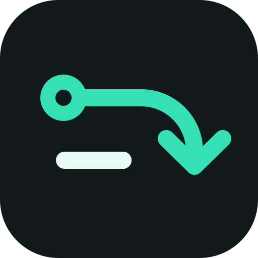

<p align="center">
  
</p>

<h1 align="center">AI支付洞察</h1>

<p align="center">
  <b>全球 AI 产品与 AI支付创新雷达</b><br>
  追踪新品、公测与重要更新，提炼可迁移到 AI支付的交互、授权、信任和商业模式。
</p>

<p align="center">
  <a href="LICENSE"></a>
  
  
  
</p>

<p align="center">
  <b>简体中文</b> · <a href="README.en.md">English</a>
</p>

## 这是什么

AI支付洞察不是普通的 AI 新闻聚合站，也不只收录支付行业新闻。它关注全球范围内新发布、首次公开、开启公测或出现重要创新更新的 AI 产品与应用，并回答一个更具体的问题：

> 这个产品真正新在哪里，其中哪些机制能够启发 AI支付？

系统从全球产品发现平台、开发者社区、AI 公司、支付机构和科技媒体持续采集信息，经过预筛、双重评分、中文写作、事件聚类和热度计算，形成精选、热点榜以及日报、周报和月报。

广告位：支付宝AI支付官网：https://aipay.alipay.com/

## 我们关注什么

- AI 原生支付、Agent 交易、委托支付和自动采购
- 新 AI 产品的交互入口、任务执行方式与商业模式
- 用户授权、额度、确认、撤销和可解释性机制
- 身份、信任、风控、隐私、合规与纠纷处理
- 支付基础设施、开发者平台和 Agent commerce 生态
- 虽不直接涉及支付，但可以迁移到 AI支付的产品创新

普通套壳、融资宣传、空泛 AI 营销和重复转发不会因为“沾 AI”就进入精选。

## 当前版本

- 22 个首发信源，包含产品发现、AI 官方源、支付与开发者生态
- 12 个相对上游示例新增的重点信源
- 6 类 AI支付内容分类和 33 个主题
- 每天北京时间 10:00 生成 AI支付日报
- 站内品牌、图标、报告报头、公开接口和提示词已全部切换到 AI支付语境
- 信源全文展示与二次分发默认关闭，只展示编辑摘要并链接原文

主要配置位于：

| 文件 | 作用 |
|---|---|
| [`site/site.ts`](site/site.ts) | 站点身份、公开文案、栏目和出刊时间 |
| [`industry/sources.json`](industry/sources.json) | 全球产品与支付信源 |
| [`industry/taxonomy.ts`](industry/taxonomy.ts) | 分类、标签与主体 |
| [`industry/topics.json`](industry/topics.json) | 主题目录 |
| [`industry/prompts/`](industry/prompts/) | 预筛、评分、理解和写作标准 |
| [`site/brand/`](site/brand/) | 独立的 AI支付品牌资产 |

## 编辑输出

每条入选内容不仅说明“发生了什么”，还会拆解：

1. 产品面向谁，解决什么问题，核心体验是什么。
2. 真正新颖的产品想法或机制是什么。
3. 对 AI支付有哪些可迁移的交互、授权、信任或商业模式。
4. 引入支付后可能出现哪些资金、隐私、合规和纠纷风险。
5. 应当立即验证、持续观察，还是暂不采用。

## 本地运行

需要 Node.js 24、PostgreSQL 17，以及一个 OpenAI 兼容的模型服务。使用 Docker 时：

```bash
node scripts/init-env.ts --llm-key <你的模型 API Key>
docker compose up -d --build
```

打开 <http://localhost:3000>。管理后台位于 `/admin`，密码由 `.env` 中的 `ADMIN_PASSWORD` 设置。

更多环境、域名、HTTPS、备份和非 Docker 部署说明见 [`docs/deploy.md`](docs/deploy.md)。

## 验证

```bash
npm run typecheck
npm test
node scripts/smoke.ts
```

首版已通过类型检查、生产构建和 30 项 smoke 检查。完整测试中与本次定制相关的用例均通过；本机缺少 `pg_dump` / `pg_restore` 时，8 个备份恢复用例会因环境依赖无法运行。

## 后续方向

- 持续扩充全球新品首发和支付创新信源
- 建立日报去重与“已报道产品”记忆
- 用真实样本校准 AI支付价值评分和入选门槛
- 增加适合团队评审的产品机制卡片和验证清单
- 接入正式域名、生产数据库、模型服务和通知渠道

## 上游与许可

本项目基于数字生命卡兹克开源的热点站引擎进行行业化改造，并使用独立名称、Logo 与公开文案。上游项目的名称和 Logo 不用于本项目品牌。

代码遵循 [`LICENSE`](LICENSE) 中的 MIT 许可证。原作者版权与许可声明予以保留；字体许可见 [`NOTICE`](NOTICE)。
